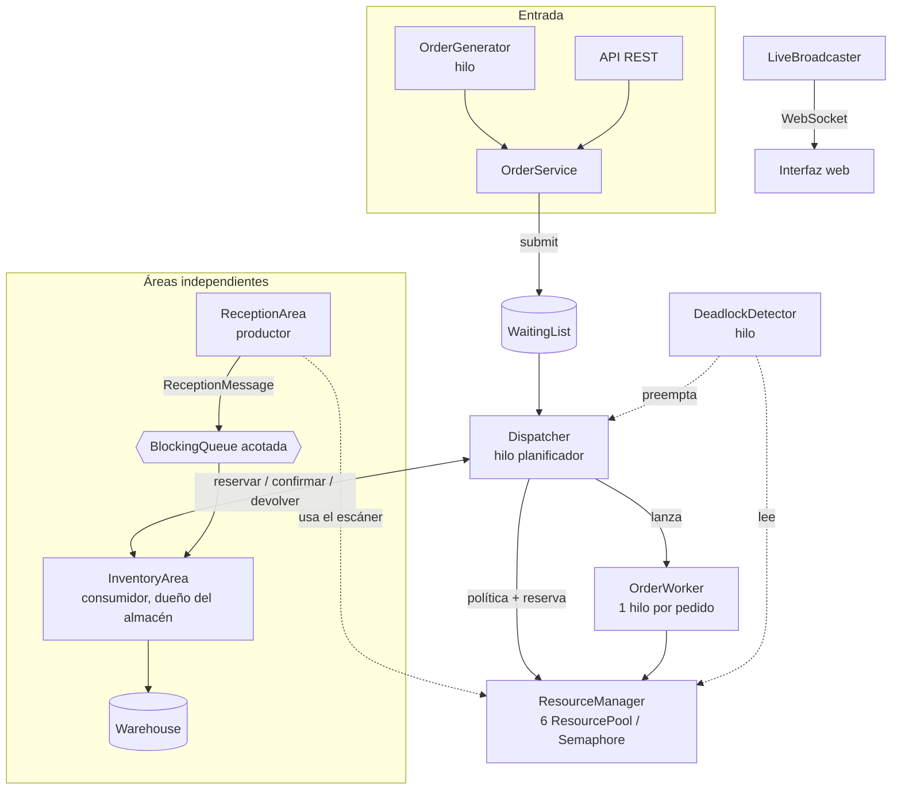

# REDxela — Manual técnico

**Sistemas Operativos 2 · Proyecto final · USAC CUNOC · Segundo semestre 2026**

Este documento describe la infraestructura del sistema y, sobre todo, **las decisiones de diseño
tomadas y su fundamento teórico**. Cada sección enlaza un concepto visto en el curso con la clase del
código que lo implementa.

---

## 1. Visión general

REDxela simula un centro de distribución: pedidos de cinco niveles de servicio compiten por seis
tipos de recursos compartidos; dos áreas independientes (Recepción e Inventario) se comunican por
mensajes; y el sistema puede entrar en un conflicto de recursos que se detecta y se resuelve.

El backend está escrito en **Java 21** con **hilos reales y mecanismos reales de sincronización**
(`Semaphore`, monitores, `ReentrantLock`/`Condition`, `BlockingQueue`); nada está simulado con
temporizadores que finjan concurrencia. Lo único simulado es el *tiempo*: un reloj propio permite que
«10 minutos de espera» no obliguen a esperar 10 minutos reales (§5.7).

### 1.1 Requisitos del enunciado y dónde se cubren

| Requisito del enunciado | Implementación |
|-------------------------|----------------|
| Recursos limitados (6 empaque, 2 áreas de carga, 10 encargados, 3 montacargas, 4 control de calidad, 1 escáner compartido, almacén) | `resource.ResourcePool`, `resource.ResourceManager`, `domain.ResourceType` |
| Cuenta de cliente nueva y tipo de servicio | `auth.*`, tabla `customer` |
| 5 niveles de servicio con tiempos objetivo | `domain.ServiceLevel` |
| Pedido con id único, cliente, nivel, productos y tipo de mercancía, unidades, estado y campos adicionales | `domain.Order`, `domain.OrderItem` |
| Generador automático sin límite + ingreso manual | `simulation.OrderGenerator`, `api.OrderController` |
| Políticas de atención y comparación de desempeño | `scheduler.*`, `simulation.PolicyComparator` |
| Unidades = carga de trabajo | `simulation.WorkEstimator` |
| ≥ 5 tipos de mercancía, combinaciones distintas, contención realista, lista de espera | `data.sql`, `domain.MerchandiseType`, `processing.Dispatcher` |
| Recepción e Inventario independientes, comunicación ordenada sin pérdida ni bloqueo indefinido | `reception.*`, `inventory.*` |
| Almacenamiento con ubicaciones físicas no contiguas | `inventory.Warehouse` |
| Conflicto de recursos provocable, visible y resoluble manualmente | `deadlock.*`, `simulation.ScenarioService` |
| Interfaz gráfica en tiempo real | `static/*`, `api.LiveBroadcaster` |
| Backend Java con hilos y sincronización reales, comentado, con manejo de excepciones | Todo el código; `api.ApiExceptionHandler` |

---

## 2. Infraestructura

### 2.1 Stack

| Capa | Tecnología | Justificación |
|------|-----------|---------------|
| Lenguaje | Java 21 | Requisito del enunciado; `java.util.concurrent` completo |
| Build | Maven 3.9+ | Estándar; el JAR ejecutable incluye la interfaz |
| Servidor | Spring Boot 3.5 (Tomcat embebido) | REST + WebSocket con poca configuración; no se usa para la lógica de concurrencia |
| Persistencia | H2 en modo archivo + `JdbcTemplate` | Cuentas y catálogo sobreviven reinicios sin instalar un servidor de BD |
| Contraseñas | `spring-security-crypto` (BCrypt) | Solo el algoritmo, sin el framework completo de seguridad |
| Interfaz | HTML + CSS + JavaScript sin dependencias | Servida por el mismo JAR; recibe el estado por WebSocket |
| Pruebas | JUnit 5, Spring Boot Test, MockMvc | 120 pruebas automáticas |

### 2.2 Estructura del proyecto

```
src/main/java/com/redxela/
├── domain/       Order, OrderItem, Product, MerchandiseType, ServiceLevel,
│                 ResourceType, OrderStatus, Customer
├── resource/     ResourcePool (semáforos + titulares), ResourceManager,
│                 AcquisitionMode
├── scheduler/    SchedulingPolicy y 4 políticas, WaitingList
├── processing/   Dispatcher (planificador), OrderWorker (hilo por pedido),
│                 OrderService, StockGate
├── reception/    ReceptionArea (productor), ReceptionMessage, AutoRestocker
├── inventory/    InventoryArea (consumidor, dueño del almacén), Warehouse
├── deadlock/     DeadlockDetector, DeadlockReport
├── stats/        StatsCollector
├── simulation/   SimClock, WorkEstimator, EventLog, OrderGenerator, OrderMix,
│                 PolicyComparator, ScenarioService, SimulationConfig
├── auth/         AuthService, AuthController, TokenStore
├── persistence/  CatalogRepository, CustomerRepository
└── api/          Controladores REST, WebSocket (LiveBroadcaster),
                  manejo de excepciones, DTOs
src/main/resources/
├── schema.sql, data.sql   Esquema H2 y datos semilla
├── application.yml        Parámetros
└── static/                index.html, app.js, styles.css
src/test/java/             120 pruebas
docs/                      Enunciado y manuales
```

### 2.3 Compilación, ejecución y pruebas

```bash
mvn test                              # 120 pruebas
mvn -DskipTests package               # genera target/redxela-0.1.0-SNAPSHOT.jar
java -jar target/redxela-0.1.0-SNAPSHOT.jar
```

La base de datos se crea en `./data/redxela.mv.db` (ignorada por git). Todos los parámetros se ajustan
en `application.yml` o por línea de comandos (`--redxela.warehouse.aisles=8`).

### 2.4 Base de datos

Solo persiste lo que debe sobrevivir a un reinicio. El estado de la simulación (pedidos, existencias,
almacén) vive en memoria y comienza limpio.

| Tabla | Contenido |
|-------|-----------|
| `merchandise_type` | Código, nombre, descripción y **recursos requeridos en orden natural de adquisición** |
| `product` | SKU, nombre y tipo de mercancía (16 productos precargados) |
| `customer` | Nombre, correo único, hash BCrypt, nivel de servicio |

### 2.5 API

| Área | Endpoints |
|------|-----------|
| Cuentas | `GET /api/service-levels` · `POST /api/auth/register` · `POST /api/auth/login` · `GET /api/auth/me` · `PUT /api/auth/service-level` · `POST /api/auth/logout` |
| Pedidos | `POST /api/orders` · `GET /api/orders?limit=` · `GET /api/orders/{id}` · `GET /api/products` · `GET /api/merchandise-types` |
| Simulación | `GET /api/state` · `GET /api/events` · `GET /api/policies` · `PUT /api/policy` · `PUT /api/mode` · `PUT /api/speed` · `POST /api/generator/start` · `POST /api/generator/stop` · `PUT /api/generator` |
| Recepción/Inventario | `POST /api/reception` · `POST /api/reception/truck` · `GET /api/reception` · `PUT /api/reception/auto-restock` · `GET /api/inventory` |
| Conflicto | `GET /api/deadlock` · `POST /api/deadlock/resolve` · `POST /api/scenarios/deadlock` · `POST /api/scenarios/contention` |
| Métricas | `GET /api/stats` · `POST /api/stats/reset` · `POST /api/compare` · `GET /api/compare` |
| Tiempo real | WebSocket `/ws`: un snapshot JSON completo cada 500 ms |

Los errores se devuelven siempre como `{"error": "..."}` con el código HTTP adecuado: 400 (datos
inválidos), 401 (sesión), 404, 405/415 (errores estándar de MVC), 409 (conflicto de estado) y 503
(Recepción saturada). Ninguna excepción interna se filtra al cliente.

---

## 3. Arquitectura



### 3.1 Hilos del sistema

| Hilo | Clase | Función |
|------|-------|---------|
| `redxela-dispatcher` | `Dispatcher` | Recorre la lista de espera en orden de política y lanza workers |
| `redxela-worker-N` | `OrderWorker` | Procesa un pedido: toma recursos, trabaja, libera |
| `redxela-generator` | `OrderGenerator` | Llegadas de Poisson de pedidos |
| `redxela-inventory` | `InventoryArea` | Consume el canal y actualiza el almacén |
| `redxela-reception-burst` | `ReceptionArea` | Camión con varios lotes |
| `redxela-restocker` | `AutoRestocker` | Reposición automática (proveedores) |
| `redxela-deadlock-detector` | `DeadlockDetector` | Revisa el grafo de espera |
| `redxela-stats` | `StatsCollector` | Muestrea la ocupación de recursos |
| `redxela-live` | `LiveBroadcaster` | Envía el snapshot por WebSocket |
| `redxela-comparator` | `PolicyComparator` | Corre la comparación de políticas |
| `http-nio-*` | Tomcat | Atiende la API (también concurrente) |

Todos son hilos *daemon* con nombre, lo que facilita su identificación en un volcado de hilos.

### 3.2 Mecanismos de sincronización utilizados

| Mecanismo | Dónde | Para qué |
|-----------|-------|----------|
| `Semaphore` contador **justo** | `ResourcePool` | Exclusión mutua y control de capacidad de cada recurso (el escáner, de capacidad 1, es un mutex) |
| Monitor (`synchronized`) | `ResourcePool.registryLock`, `WaitingList`, `Warehouse`, `SimClock`, `StatsCollector` | Estructuras compartidas pequeñas |
| `ReentrantLock` | `ResourceManager.atomicLock` | Serializar los intentos de adquisición atómica |
| `ReentrantLock` + `Condition` | `Dispatcher.wakeLock` | Despertar al planificador (con bandera `wakePending`) |
| `BlockingQueue` acotada (`ArrayBlockingQueue`) | Canal Recepción → Inventario | Productor/consumidor con contrapresión |
| `volatile` | `Order` (estado, progreso…), `Dispatcher.policy/mode` | Visibilidad entre hilos sin bloqueo |
| `ConcurrentHashMap`, `ConcurrentSkipListMap`, `CopyOnWriteArrayList` | Workers en curso, sesiones, pedidos retenidos, *listeners* | Colecciones concurrentes |
| `AtomicLong/Integer` | Contadores de ids, lotes y estadísticas | Contadores sin cerrojo |
| Interrupción de hilos | Preempción y apagado | Cancelar esperas bloqueantes |

---

## 4. Decisiones de diseño y fundamento teórico

### 4.1 Recursos como semáforos contadores *(exclusión mutua, semáforos)*

**Decisión.** Cada tipo de recurso es un `ResourcePool` con un `Semaphore(capacidad, fair = true)`:
`acquire()` es *P/wait*, `release()` es *V/signal*. Los 3 montacargas son un semáforo contador
inicializado en 3; el escáner, uno binario (equivale a un *mutex*).

**Por qué un semáforo y no un monitor.** Los recursos son **múltiples instancias idénticas**: lo que
importa es *cuántas* unidades hay libres, no *cuál*. Es exactamente el problema para el que se definió
el semáforo contador. Se pidió modo **justo (FIFO)** para evitar la *inanición* de quien espera: sin
justicia, un hilo que reintenta continuamente podría superar siempre al que lleva más tiempo bloqueado.

**El semáforo no sabe quién lo tiene.** Para mostrar «en uso, y por quién», y para poder detectar
deadlocks, `ResourcePool` mantiene aparte el conjunto de *titulares* y el de *en espera*. Ese
registro se protege con un monitor propio que **nunca se mantiene mientras se bloquea** en el
semáforo (si no, nadie podría liberar ni consultar el estado: un deadlock introducido por el propio
diseño). El `release()` es **idempotente**: solo devuelve el permiso si el dueño realmente lo tenía,
para que un `finally` que libera dos veces no «infle» el semáforo y rompa la exclusión mutua.

**Equidad en el intento sin bloqueo.** `Semaphore.tryAcquire()` sin plazo *se cuela* delante de la cola
aunque el semáforo sea justo (documentado en la API de Java). El despachador usa `tryAcquire` y
dejaba sin escáner a Recepción, que esperaba bloqueada. Se corrigió usando la variante con plazo
(`tryAcquire(0, ms)`), que sí respeta la cola FIFO (§7, problema 3).

### 4.2 Planificación de pedidos *(algoritmos de planificación)*

La lista de espera es una cola de *listos*; el recurso escaso es el conjunto de estaciones, y el
planificador decide a quién se le asignan. Se implementó el patrón *Strategy* (`SchedulingPolicy`
devuelve un comparador) para intercambiar la política en caliente y reordenar la lista al instante.

| Política | Algoritmo clásico | Ventaja | Riesgo |
|----------|-------------------|---------|--------|
| `StrictPriorityPolicy` | Prioridad estática | Cumple el nivel alto | **Inanición** de los niveles bajos |
| `AgingPolicy` *(defecto)* | Prioridad con *aging* | Ninguna espera es infinita | Algo menos de ventaja para el nivel 1 |
| `ShortestOrderFirstPolicy` | SJF (el trabajo más corto) | Mínimo tiempo de espera promedio; libera estaciones rápido | Inanición de pedidos grandes; ignora el nivel |
| `FcfsPolicy` | FCFS | Simple y justa | Efecto convoy; ignora urgencia |

**Aging.** Prioridad efectiva = `nivel − minutos_en_espera / 10`. Un pedido Económico (nivel 5) que
lleva 40 min esperando compite como uno de nivel 1. Es la contramedida clásica a la inanición.
Se probó que **sin** aging el Económico nunca adelanta (`SchedulingPolicyTest`).

**El tamaño del pedido es el tiempo de ejecución.** Como exige el enunciado, `WorkEstimator` fija el
trabajo como `unidades × 0.25 min`. Por eso «menor cantidad primero» es una versión directa de **SJF**:
conocemos la duración de antemano, que es lo que SJF requiere (en un SO real habría que estimarla).

**Resultados medidos (comparador, 90 min simulados, 4 pedidos/min, semilla 42):**

| Política | Completados | Espera prom. | Cumple objetivo | Espera por nivel (1·2·3·4·5) |
|----------|:-----------:|:------------:|:---------------:|------------------------------|
| Envejecimiento | 175 | 23.3 min | 58 % | 12 · 17 · 21 · 29 · 34 |
| Prioridad estricta | 173 | 23.1 min | 61 % | **2 · 6** · 24 · 35 · 39 |
| Menor cantidad primero | **232** | **16.6 min** | **72 %** | 17 · 16 · 17 · 12 · 22 |
| FCFS | 176 | 23.2 min | 51 % | 23 · 25 · 22 · 24 · 23 |

Lectura: FCFS reparte la espera por igual (ignora la urgencia). La prioridad estricta atiende al
Exprés en ~2 min pero castiga al Económico (39). El envejecimiento es el **compromiso**: el Exprés
espera 12 min pero el Económico solo 34. «Menor cantidad primero» logra más pedidos completados y la
menor espera promedio —lo que predice la teoría de SJF— pero **pierde la diferenciación por nivel de
servicio** (el Exprés espera 17 min). No hay una política mejor en todo: depende del objetivo de negocio.

**Cómo se compara.** `PolicyComparator` genera **una carga** con semilla fija (`OrderMix`) y se la aplica
a cada política en un sistema aislado, usando el **mismo `Dispatcher`** (no un modelo paralelo). Al cortar
quedan pedidos sin iniciar; su espera se toma como la edad que llevan (observación *censurada*) y el
cumplimiento solo cuenta pedidos con desenlace decidido, para no premiar a una política que deja
pedidos sin atender. Como corre con hilos reales, hay una variación menor entre corridas.

### 4.3 El despachador: asignación atómica y reserva *(prevención de deadlock, inanición)*

El `Dispatcher` recorre la lista **en el orden de la política** y, en modo atómico, intenta tomar **todos**
los recursos del pedido con `tryAcquireAll`. Si no alcanzan, el pedido **sigue en la lista de espera**
(así se cumple «cuando un pedido no puede obtener de inmediato los recursos, pasa a una lista de espera»).

* **Asignar todo o nada niega la condición de «retener y esperar»** (§4.4): un pedido nunca retiene
  parte de sus recursos mientras espera el resto, así que el deadlock es imposible. `tryAcquireAll` hace
  *rollback* de lo ya tomado si falta alguno y se serializa con un cerrojo para evitar que dos pedidos
  se quiten mutuamente recursos a medias y reviertan a la vez (*livelock*).
* **Reserva del cuello de botella.** Si el pedido más prioritario está bloqueado, otros menos
  prioritarios podrían usar los recursos que él necesita en cuanto se liberen y **dejarlo sin atender
  nunca** (inanición por *backfilling* sin control). Por eso un pedido bloqueado **reserva los recursos
  agotados que le faltan** (su cuello de botella): los pedidos de menor prioridad solo pasan si no los
  necesitan. Se reserva solo el cuello de botella, no todos sus recursos: una versión inicial reservaba
  todos y dejaba estaciones ociosas con la lista creciendo (§7, problema 2).
* **Existencias.** Antes de competir por recursos, el pedido debe tener **existencias** (§4.6). Sin ellas
  pasa a *Sin existencias* y no bloquea ni reserva nada: espera al inventario, no a las estaciones.
* **Despertar sin pérdida de señales.** El planificador duerme en una `Condition`. Una señal que llega
  mientras despacha se perdería (las `Condition` no la recuerdan), retrasando pedidos hasta 100 ms y
  alterando el orden. Se añadió una bandera `wakePending` protegida por el mismo cerrojo (§7, problema 1).

### 4.4 Deadlock *(condiciones de Coffman, prevención, detección, recuperación)*

Un deadlock exige **las cuatro condiciones de Coffman** a la vez:

1. **Exclusión mutua** — los recursos no se comparten (semáforos).
2. **Retener y esperar** — un proceso retiene recursos mientras pide otros.
3. **Sin expropiación** — los recursos no se quitan a la fuerza.
4. **Espera circular** — hay un ciclo de procesos, cada uno esperando a otro.

El sistema implementa **tres estrategias**, seleccionables con el modo de adquisición, para poder
contrastarlas:

| Modo | Estrategia | Condición que niega |
|------|-----------|---------------------|
| `ATOMIC` | **Prevención** | *Retener y esperar* (todo o nada) |
| `ORDERED` | **Prevención** | *Espera circular* (orden global de recursos: todos piden siguiendo el orden del enum `ResourceType`) |
| `NATURAL` | **Detección y recuperación** | Ninguna: el deadlock puede ocurrir |

**Por qué hay un modo que lo permite.** El enunciado pide poder *llegar deliberadamente* al conflicto,
mostrarlo y resolverlo. Se descartó la **evitación** (algoritmo del banquero) porque exige conocer de
antemano el máximo de recursos de cada proceso y evaluar cada solicitud; la prevención atómica es más
simple y suficiente aquí.

**Cómo se provoca.** `PESADO` pide `Encargado → Montacargas → Área de carga` y `VOLUMINOSO` pide
`Empaque → Área de carga → Montacargas`: los mismos dos recursos **en sentido inverso**. Con 3 pesados y
2 voluminosos: los pesados retienen los 3 montacargas y piden área de carga; los voluminosos retienen
las 2 áreas y piden montacargas. Ciclo cerrado. (`ScenarioService.provokeDeadlock`.)

**Cómo se detecta.** Con recursos de **múltiples instancias** un ciclo en el grafo de espera *no basta*:
otro titular (que no espera) podría liberar una unidad y deshacer el ciclo. `DeadlockDetector` usa el
algoritmo de detección para múltiples instancias:

1. `Trabajo` = unidades disponibles de cada recurso.
2. Los procesos que **no esperan** nada terminarán y devolverán lo que retienen: se suman a `Trabajo`.
3. Se «terminan» iterativamente los que esperan un recurso con `Trabajo ≥ 1`, devolviendo lo que retienen.
4. Los que **no pueden terminar** están en deadlock.

Como las fotos de los recursos no se toman de forma atómica, un deadlock solo se **confirma si aparece con
el mismo conjunto en dos revisiones consecutivas**: un deadlock real persiste; una lectura inconsistente
pasajera, no. Se probó que en los modos preventivos nunca hay falsos positivos bajo estrés.

**Cómo se resuelve (recuperación).** La resolución es **manual**, como pide el enunciado: el operador
elige qué pedido **continúa**. Los demás son **expropiados** (se les interrumpe el hilo; liberan sus
recursos en un `finally`) y regresan a la lista de espera con una marca de **diferimiento**: no vuelven a
competir hasta que el elegido termine. Sin esa marca el despachador los relanzaría de inmediato y
volverían a formar el mismo ciclo. Esto es *recuperación por expropiación con retroceso* (*rollback*): el
progreso de la víctima se descarta y se reinicia desde cero.

La interrupción se protege con una bandera `done` y un monitor: si el worker ya terminó, no se
interrumpe, porque el hilo pertenece a un *pool* y la interrupción tardía caería sobre **otro pedido**.

### 4.5 Comunicación entre áreas *(productor/consumidor, IPC)*

Recepción e Inventario son **procesos independientes** que no deben modificar las estructuras del otro.
Se comunican únicamente por un **canal de mensajes**: una `ArrayBlockingQueue<ReceptionMessage>` acotada.

* **Mensajes inmutables** (`record ReceptionMessage`): pasan de un área a otra sin compartir estado mutable.
* **Productor/consumidor.** Recepción (productor) escanea el lote y lo deja en el canal; Inventario
  (consumidor, en su propio hilo) lo procesa **a su propio ritmo**.
* **Buffer acotado = contrapresión.** Si Recepción produce más rápido de lo que Inventario procesa, el
  canal se llena y `put()` **bloquea** al productor en vez de perder datos o consumir memoria sin límite.
  Esto cumple «sin pérdida de datos ni bloqueos indefinidos»: el productor espera, pero Inventario
  siempre drena, así que la espera es finita.
* **Llamadas interactivas con plazo.** Para no colgar una petición HTTP, el registro manual usa
  `offer(timeout)`. Si no hay lugar responde 503 («Inventario saturado»): el lote **no fue aceptado**, pero
  tampoco se perdió; el llamador sabe que debe reintentar.
* **Recepción comparte el escáner** con el despacho: pide el mismo `ResourcePool` del escáner con un
  dueño de id negativo (lote), con plazo. Así la contención por el escáner único es real.
* **Propiedad exclusiva.** Solo `InventoryArea` muta el almacén y las existencias. El despachador no las
  toca: usa la interfaz `StockGate` (reservar / confirmar / devolver).

### 4.6 Existencias con reserva en dos fases *(consistencia)*

Para que dos pedidos no «vendan» las mismas unidades, el inventario las **reserva** al iniciar el pedido
(`tryReserve`, todo o nada), las **confirma** al terminar (`commit`: salen del almacén) o las **devuelve**
si el pedido se interrumpe (`release`). Existencias disponibles = unidades en el almacén − reservadas.
El `commit` ocurre **antes** de publicar el estado `COMPLETADO`, para que nadie observe un pedido
completado cuyas unidades aún figuran en el almacén (§7, problema 4).

Al llegar mercadería, Inventario avisa por *listener* al despachador, que **reevalúa** los pedidos en
estado *Sin existencias* (requisito del enunciado).

### 4.7 Administración del almacenamiento *(asignación de memoria no contigua)*

`Warehouse` es una cuadrícula de **pasillos × niveles × posiciones** (5 × 4 × 4 = 80 ubicaciones de 25
unidades = 2000). Cada ubicación guarda un solo producto. Es un análogo directo de la **asignación no
contigua** de memoria:

* **Primer ajuste (*first-fit*).** Un lote se reparte primero completando las ubicaciones parciales del
  *mismo* producto (esté donde esté) y luego usando las vacías en orden físico. Un lote grande queda
  repartido en ubicaciones **no contiguas**, como describe el enunciado.
* **Fragmentación.** Con el tiempo hay ubicaciones medio vacías ocupadas por un producto: espacio libre que
  otro producto **no puede usar** (fragmentación interna). Por eso la ocupación puede llegar a rechazar
  unidades con el almacén «no lleno» (`rechazó N u. por falta de espacio` en la interfaz).
* **Retiro.** Se vacían primero las ubicaciones con *menos* stock para liberar ubicaciones completas y
  reducir la fragmentación.

### 4.8 Tiempo simulado

`SimClock` convierte minutos simulados a milisegundos reales con una escala y una **velocidad ajustable en
caliente**. Al cambiar la velocidad se **re-ancla** el tiempo acumulado, de modo que `now()` nunca retrocede
ni da saltos. Todas las esperas, objetivos de nivel y duraciones se expresan en minutos simulados.
Los hilos duermen en tramos cortos y recalculan, por lo que reaccionan a cambios de velocidad.

### 4.9 Manejo de excepciones y apagado

* **API.** `ApiExceptionHandler` traduce cada excepción a un código HTTP y a un cuerpo JSON uniforme. Respeta
  el código de las excepciones estándar de Spring (`ErrorResponse`) en lugar de convertirlas en 500, y
  registra (sin filtrar al cliente) los errores realmente inesperados.
* **Hilos.** Cada bucle (`Dispatcher`, `OrderGenerator`, `InventoryArea`…) captura `RuntimeException` por
  iteración: un pedido o aviso defectuoso se registra en la bitácora y **no mata al hilo**.
* **Recursos.** Todo `acquire` va emparejado con una liberación en `finally`, y `releaseAll` es idempotente.
  Si un worker falla por un error inesperado, sus recursos se liberan y el pedido se reencola.
* **Apagado ordenado.** Spring invoca `stop()` de cada componente: se interrumpen los hilos, los workers
  liberan lo que tienen y las reservas de existencias se devuelven. Hay una prueba que lo verifica.

### 4.10 Seguridad

Contraseñas con **BCrypt**; la API nunca devuelve el hash. Sesiones con token opaco aleatorio
(`SecureRandom`) en un `ConcurrentHashMap`. El registro concurrente con el mismo correo lo resuelve la
**restricción `UNIQUE` de la base de datos** (única garantía real ante concurrencia), no una comprobación
previa. La interfaz escapa todo texto del servidor antes de insertarlo en el DOM (los nombres de clientes
son entrada del usuario). El WebSocket solo acepta orígenes locales.

---

## 5. Modelo de concurrencia: recorrido de un pedido

1. **Llegada.** El generador o la API llama a `OrderService.create`: valida, asigna un id único, estima el
   trabajo (`unidades × 0.25`) y lo entrega al `Dispatcher` (`submit` → `WaitingList`).
2. **Planificación.** El despachador (despertado por la señal) ordena la lista con la política activa. Para
   cada pedido: ¿hay existencias? ¿no rebasa a un pedido bloqueado de mayor prioridad? ¿se pueden tomar
   **todos** sus recursos? Si sí, reserva las existencias, lo retira de la lista y **lanza un `OrderWorker`**.
3. **Procesamiento.** El worker mantiene los recursos durante `workMinutes` (en tramos de ≤ 40 ms, publicando
   el progreso). En modos incrementales pide los recursos uno por uno.
4. **Finalización.** Confirma la salida de existencias, marca `COMPLETADO`, libera los recursos (`finally`),
   notifica a las estadísticas y despierta al despachador.
5. **Alternativa.** Si es expropiado (deadlock), libera, devuelve las existencias y regresa a la lista con
   diferimiento.

---

## 6. Pruebas

120 pruebas automáticas (`mvn test`), incluyendo pruebas de **concurrencia con hilos reales**:

| Suite | Pruebas | Qué verifica |
|-------|:-------:|--------------|
| `ResourcePoolTest`, `ResourceManagerTest` | 10 | Nunca más titulares que capacidad bajo 20 hilos; escáner = mutex; liberación idempotente; interrupción sin fugas; sin colarse en la cola FIFO; orden global sin espera circular; adquisición atómica sin bloqueo bajo estrés |
| `SchedulingPolicyTest` | 7 | Orden de cada política; aging promueve al antiguo y la prioridad estricta no; lista segura concurrente |
| `DispatcherTest` | 8 | Completa todo sin exceder capacidad; prioridad estricta; reserva del cuello de botella; preempción; **deadlock deliberado en modo NATURAL y su resolución**; sin deadlock en modo ordenado |
| `DispatcherStockTest` | 4 | Pedido sin stock espera y se reevalúa; las reservas evitan doble venta; preempción devuelve existencias |
| `DeadlockDetectorTest` | 8 | Algoritmo con instancias múltiples (incluye ciclos aparentes que **no** son deadlock); detección, descripción y resolución con hilos reales; **sin falsos positivos** en modos preventivos bajo estrés |
| `WarehouseTest`, `InventoryAreaTest` | 13 | Asignación no contigua; rechazo por falta de espacio; reservas; **Recepción rápida / Inventario lento sin pérdida** |
| `ReceptionAreaTest` | 6 | Escáner compartido; canal lleno sin pérdida; camión con contrapresión; reposición automática |
| `PolicyComparatorTest`, `OrderMixTest` | 7 | Misma carga para todas las políticas; reproducibilidad por semilla; prioridad estricta favorece al Exprés |
| `StatsCollectorTest`, `EventLogTest`, `SimClockTest`, `OrderTest`, `OrderGeneratorTest`… | 24 | Métricas, reloj, bitácora, dominio |
| Pruebas de API (`*ControllerTest`, `LiveBroadcasterTest`) | 33 | Contratos REST, validaciones, códigos HTTP, registro concurrente con el mismo correo, flujo completo del deadlock por API, WebSocket con varios clientes |

**Prueba de resistencia sobre la aplicación real.** Con carga alta (4 pedidos/min a 10×), reposición
automática y después modo `NATURAL` con resolución automática de cada deadlock: más de 3 200 pedidos
procesados y 11 deadlocks resueltos en una sola corrida. Al drenar el sistema: **0 recursos con titulares o
esperas, 0 reservas pendientes, canal vacío y 0 errores en el log.**

---

## 7. Problemas encontrados y cómo se resolvieron

Documentar los errores reales muestra qué se aprendió. Todos se descubrieron con pruebas o observando la
interfaz, y todos tienen prueba de regresión.

| # | Problema | Causa | Solución |
|---|----------|-------|----------|
| 1 | Pedidos admitidos hasta 100 ms tarde; el escenario de deadlock no formaba el ciclo | **Despertar perdido** (*lost wakeup*): `Condition.signalAll()` no recuerda señales que llegan mientras el planificador no está esperando | Bandera `wakePending` bajo el mismo cerrojo; el planificador no duerme si hay una señal pendiente |
| 2 | Con 119 pedidos en espera solo 3 en proceso, y Control de calidad ocioso | La reserva bloqueaba **todos** los recursos de un pedido bloqueado, y de forma **transitiva** a los que solo chocaban con otro reservado | Reservar únicamente el **cuello de botella** y no propagar la reserva |
| 3 | «Esperan: Lote 19» durante minutos; Recepción no lograba escanear | `Semaphore.tryAcquire()` **se cuela** delante de la cola aunque el semáforo sea justo | `tryAcquire(0, ms)`, que respeta el FIFO |
| 4 | Un pedido aparecía `COMPLETADO` con el almacén sin descontar | La salida de existencias se confirmaba en el `finally`, *después* de publicar el estado | Confirmar la salida **antes** de marcar `COMPLETADO` |
| 5 | El escenario de deadlock fallaba con el almacén casi vacío | Los pedidos esperaban existencias y arrancaban escalonados, rompiendo el entrelazado | El escenario espera a que el reabastecimiento llegue antes de crear los pedidos; avisa si hay otros en curso |
| 6 | `POST` a un endpoint `PUT` devolvía 500 | La red de seguridad `Exception → 500` tragaba las excepciones estándar de MVC | Respetar `ErrorResponse` (405, 415…) |
| 7 | El registro desde la web enviaba el nombre vacío | En un `<form>`, `form.name` es el atributo del formulario, no el campo `name` | Leer `form.elements.name` |
| 8 | Los cambios en CSS/JS no se veían tras recompilar | El JAR sirve los estáticos con `Last-Modified` fijo (build reproducible) y el navegador los cachea casi indefinidamente | `Cache-Control: no-store` para los estáticos |
| 9 | Prueba intermitente sobre «quién inició primero» | Dos workers marcan su inicio desde hilos distintos; difieren en microsegundos | La aserción compara con tolerancia (una *race* de la prueba, no del sistema) |

---

## 8. Limitaciones y trabajo futuro

* Cada pedido mantiene **todos** sus recursos durante todo su procesamiento. Un modelo más fino liberaría
  cada recurso al terminar su etapa; aquí se prefirió simplicidad y poder razonar sobre la prevención.
* El estado de la simulación (pedidos, almacén) es volátil; solo cuentas y catálogo persisten.
* Un pedido con muchos tipos de mercancía necesita la unión de sus recursos y es difícil de atender en modo
  atómico (el despachador evita la inanición con la reserva, pero tarda más).
* Las sesiones son en memoria (se pierden al reiniciar el servidor).
* El comparador usa hilos reales, por lo que sus resultados tienen una pequeña variación entre corridas;
  un simulador de eventos discretos sería determinista a costa de modelar el sistema por separado.
